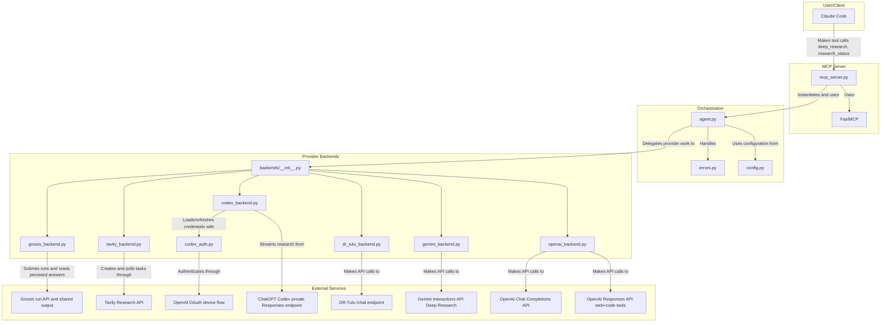

# Architecture

This document provides a detailed overview of the `deep-research-mcp` project architecture, including component interactions and file-by-file descriptions.

## Build and Dependency Management

- Packaging metadata is defined in `pyproject.toml` (PEP 621) using `setuptools` with a `src/` layout.
- Dependency constraints are minimum-version (`>=`) specifications in `pyproject.toml`.
- `requirements.txt` is a compatibility install file that also uses unpinned `>=` constraints.
- `uv.lock` is not tracked, so CI/dev environments resolve the latest compatible versions.
- Console scripts expose the MCP server as `deep-research-mcp`
  (`deep_research_mcp.mcp_server:main`) and the unified CLI, including Codex
  authentication, as `deep-research-cli` (`deep_research_mcp.cli:main`).

## Architectural Diagram

## Component Descriptions

The project is composed of four main layers:

1.  **MCP Server (`mcp_server.py`)**: This is the entry point for external clients like Claude Code. It uses the `mcp.server.fastmcp` module from the official MCP Python SDK to expose the core research functionality as tools. It handles incoming requests, initializes one `DeepResearchAgent` per configured backend, and returns structured results. It includes three tools: `deep_research()`, `research_status()`, and `list_backends()`.

2.  **Orchestration (`agent.py`, `config.py`, `errors.py`)**: This layer contains the application-facing orchestration logic.
    *   `agent.py` owns the top-level research flow, completion callbacks, status lookup, and delegation to the configured backend. It does not embed provider-specific execution logic directly.
    *   `config.py` handles loading and validating configuration from `~/.deep_research` and environment variables, including provider selection and named `[backends.<name>]` tables.
    *   `errors.py` defines custom exception classes for better error handling.
    *   `cli.py` provides the installed direct-agent, MCP-client, configuration,
        and Codex authentication commands.

3.  **Provider Backends (`backends/`)**: This layer isolates provider-specific initialization, request execution, polling, and result extraction.
    *   `backends/base.py` defines the backend interface used by `DeepResearchAgent`.
    *   `backends/openai_backend.py` implements the OpenAI Responses API and Chat Completions flows, including citation extraction and background polling.
    *   `backends/gemini_backend.py` implements Gemini Deep Research over the Interactions API, including polling and result normalization.
    *   `backends/tavily_backend.py` implements Tavily Research task creation, polling, and report recovery.
    *   `backends/gnosis_backend.py` submits Gnosis search runs, reads telemetry, and recovers full answers from a shared output directory.
    *   `backends/dr_tulu_backend.py` implements the DR-Tulu research agent integration via Allen AI's `/chat` endpoint.
    *   `backends/codex_backend.py` implements experimental ChatGPT subscription access through the private Codex Responses stream.
    *   `codex_auth.py` owns the separate device-code session, optional access-token-only Codex import, atomic token rotation, and local logout.

4.  **External Services**: This layer represents the external systems used:
    * Provider `openai` with `api_style = "responses"` (default): OpenAI Responses API with web search and code interpreter tools.
    * Provider `openai` with `api_style = "chat_completions"`: OpenAI Chat Completions API -- works with any OpenAI-compatible provider (Perplexity, Groq, Ollama, vLLM, etc.). No built-in tools (`web_search`, `code_interpreter`); no background mode or polling.
    * Provider `gemini`: Gemini Deep Research agent over the Interactions API. Background execution and polling are required; built-in Google Search and URL context are provided by Gemini.
    * Provider `tavily`: Tavily Research over its asynchronous Research API. Task IDs support polling and completed-report recovery; `mini` is the default model.
    * Provider `gnosis`: self-hosted openJiuwen DeepSearch `POST /runs` on port 8089, forced to state-space search with the question router disabled. Native request settings live in a private JSON file. Full-answer recovery requires a shared output mount; telemetry alone is insufficient. No SDK dependency or Code Interpreter support.
    * Provider `dr-tulu`: Allen AI's DR-Tulu research agent accessed via its `/chat` endpoint. A lightweight integration that delegates research to a separately hosted DR-Tulu service.
    * Provider `openai-codex`: account-scoped model discovery followed by a synchronous SSE Responses request with native web search. Code Interpreter, background polling, cancellation, task recovery, and endpoint overrides are intentionally unsupported.

## File-by-File Breakdown

### `src/deep_research_mcp/agent.py`

-   **Purpose**: Contains the `DeepResearchAgent` class, which orchestrates research execution, status lookup, and callbacks.
-   **Key Functionality**:
    -   `research()`: Passes the caller's query and system prompt unchanged to the configured backend and optionally triggers completion callbacks.
    -   `_send_completion_callback()`: Sends a notification to a callback URL when the research is complete.
    -   `get_task_status()`: Allows checking the status of a running research task.
    -   `get_task_result()`: Retrieves a completed task result when the backend supports recovery.

### `src/deep_research_mcp/cli.py`

-   **Purpose**: Implements the installed `deep-research-cli` console command.
-   **Key Functionality**:
    -   Runs direct research or connects to a Streamable HTTP MCP server.
    -   Direct-agent mode retains formatted reports and optional JSON output. MCP mode serializes the structured research/status object as JSON for display or research output files, preserving the nested recovery `result`.
    -   `--backend NAME` selects a `[backends.<name>]` table via `ResearchConfig.load(backend=...)`; `check_backend_flags()` rejects it alongside provider-scoped override flags. In MCP client mode the name is forwarded as the `backend` tool argument.
    -   Displays resolved configuration and checks task status. In direct mode `status` splits `<backend>:<id>` task IDs with `split_backend_task_id()` so IDs copied from MCP output reach the right backend; a prefix that disagrees with an explicit `--backend` is an error. In MCP client mode it applies `prefix_task_id_with_backend()` so a raw ID is sent as `<backend>:<id>`.
    -   Manages the independent OpenAI Codex login, status, and logout flows.

### `cli/deep-research-tui.py`

-   **Purpose**: Full-screen Textual UI over the same two modes as the CLI: direct agent and MCP client.
-   **Key Functionality**:
    -   `StartupState` carries the parsed flags, including `backend`, into the app; `main()` loads the chosen backend with `ResearchConfig.load(backend=...)` to pre-fill the form.
    -   `_build_config()`: Builds the config from the form. With a named backend it loads that table for provider, API style and credentials and only takes model, endpoint and reasoning effort from the form; the provider and API style selects are disabled.
    -   `_status_config()`: Picks the backend for a direct-mode status check. A recognized `<backend>:` prefix selects that backend; a raw ID uses the backend the TUI was started with.
    -   `_check_mcp_status()`: Sends an explicit prefix unchanged and prefixes a raw ID with the startup backend via `prefix_task_id_with_backend()`.
    -   `_run_mcp_research()`: Forwards the startup backend as the `backend` tool argument.
    -   MCP research/status output is displayed and saved as JSON, including nested recovered results. Direct-agent report formatting and its JSON toggle are unchanged.

### `src/deep_research_mcp/backends/__init__.py`

-   **Purpose**: Exposes the provider backend interface and backend factory.
-   **Key Functionality**:
    -   `build_research_backend()`: Selects the correct backend implementation for the configured provider.

### `src/deep_research_mcp/backends/base.py`

-   **Purpose**: Defines the shared backend contract used by the orchestration layer.
-   **Key Functionality**:
    -   `ResearchBackend`: Base interface for provider implementations.
    -   `_combine_system_prompt()`: Shared helper for combining top-level system instructions with the user query.

### `src/deep_research_mcp/backends/openai_backend.py`

-   **Purpose**: Implements OpenAI Responses API and Chat Completions execution paths.
-   **Key Functionality**:
    -   `research()`: Routes between Responses API and Chat Completions mode based on `api_style`.
    -   `_create_research_task()`: Starts an OpenAI background research task (Responses API) with retry logic.
    -   `_wait_for_completion()`: Polls the Responses API task until completion, failure, or timeout.
    -   `_extract_openai_results()`: Parses final OpenAI response and extracts report, citations, and metadata.
    -   `_run_chat_completions_research()`: Runs research via the Chat Completions API.
    -   `_create_chat_completions_request()`: Retry-wrapped Chat Completions API call.
    -   `_extract_chat_completions_results()`: Parses Chat Completions response into the standard output dict.
    -   `_extract_chat_completions_citations()`: Multi-layer citation extraction (Perplexity-style, annotation-based, regex fallback).
    -   `get_task_status()`: Returns OpenAI task status or an `unknown` status for Chat Completions mode.

### `src/deep_research_mcp/backends/codex_backend.py`

-   **Purpose**: Isolates the undocumented ChatGPT Codex endpoint from the public OpenAI API backend.
-   **Key Functionality**:
    -   Fetches the signed-in account's ordered `/models` catalogue with a fallback Codex client version (`0.156.1`), using a newer installed `codex --version` when available, and resolves `model = "auto"`.
    -   Sends an honestly identified, web-search-enabled `/responses` request and assembles raw SSE deltas, annotations, searches, and terminal status.
    -   Retries once after a pre-stream `401`, but never retries a partially consumed stream.
    -   Returns `unknown` for task status because streamed results cannot be recovered.

### `src/deep_research_mcp/codex_auth.py`

-   **Purpose**: Manages the independent OpenAI Codex subscription OAuth session.
-   **Key Functionality**:
    -   Runs the Codex device-code flow and refreshes rotating tokens under a cross-process file lock.
    -   Stores credentials atomically in `~/.deep_research_auth.json` with owner-only permissions.
    -   Optionally imports only the current access token from `${CODEX_HOME:-~/.codex}/auth.json`, preventing refresh-token conflicts with Codex.
    -   Provides status and local logout operations used by the unified CLI.

### `src/deep_research_mcp/backends/gemini_backend.py`

-   **Purpose**: Implements Gemini Deep Research over the Interactions API.
-   **Key Functionality**:
    -   `_init_gemini()`: Initializes the Gemini `google-genai` client and Interactions resource with beta API settings.
    -   `_run_research()`: Starts a Gemini Deep Research background interaction and normalizes the completed result.
    -   `_wait_for_completion()`: Polls Gemini interaction status until completion, failure, or timeout.
    -   `extract_results()`: Parses Gemini interaction outputs into the project's standard report/citation format.
    -   `get_task_status()`: Returns Gemini interaction status metadata.

### `src/deep_research_mcp/backends/tavily_backend.py`

-   **Purpose**: Implements Tavily Research over its asynchronous Research API.
-   **Key Functionality**:
    -   `research()`: Starts a task with the configured `mini`, `pro`, or `auto` model and polls for its report.
    -   `get_task_status()` and `get_task_result()`: Retrieve task status and recover completed reports by ID.
    -   `_extract_result()`: Converts Tavily's report and source list into the shared result format.

### `src/deep_research_mcp/backends/gnosis_backend.py`

- **Purpose**: Runs Gnosis state-space search through a separately deployed service.
- `research()` reads `gnosis_config_path`, generates a fresh run ID, invokes the
  task-start callback, and polls the full run telemetry range. Full re-reads avoid
  losing events delivered out of sequence; submissions are not automatically retried.
- `get_task_status()` / `get_task_result()` map the internal conversation ID from
  `run_started` to `gnosis_output_dir/logs/result_<id>/final_result.json`. Path
  traversal and escaping symlinks are rejected. Missing or partial files are not
  interpreted as successful answers; nonterminal history cannot prove liveness.
- Confirmed predictions become reports. Inline Markdown links become citations;
  fetched-but-uncited evidence is not promoted to citations. Guesses/empty answers
  remain failures, and timeout preserves the ID with optional cancellation.
- The MCP server must share the output mount. Server restart recovery of active
  searches and HTTP-only report recovery are not supported by this upstream API.

### `src/deep_research_mcp/backends/dr_tulu_backend.py`

-   **Purpose**: Implements the DR-Tulu research agent integration.
-   **Key Functionality**:
    -   `research()`: Sends research queries to the DR-Tulu `/chat` endpoint and returns normalized results.
    -   `_build_citations()`: Converts DR-Tulu searched links into the standard citation format.
    -   `get_task_status()`: Returns an `unknown` status because DR-Tulu does not support persistent task tracking.

### `src/deep_research_mcp/mcp_server.py`

-   **Purpose**: Implements the MCP (Model-Client Protocol) server using the `mcp.server.fastmcp` module from the official MCP Python SDK. Supports both stdio and HTTP (streaming) transports. Exposes the research functionality as tools that can be called by clients like Claude Code or any MCP‑compatible client.
-   **Key Functionality**:
    -   `_ensure_research_agent(backend)`: Lazily builds and caches one `DeepResearchAgent` per backend name in the module-level `_agents` dict. `"default"` (or an empty name) is the `[research]` table; other names resolve to `[backends.<name>]` via `ResearchConfig.load(backend=...)`. The `--cancel-on-timeout` override and log level are applied per build and are server-wide.
    -   `_tag_task_id()` / `_split_task_id()`: Task IDs returned to clients are `<backend>:<provider task id>` so `research_status` can route them to the backend that owns them without server-side state; un-prefixed IDs go to the default backend and are prefixed in the response. Providers and the webhook callback payload sent by `DeepResearchAgent` still use raw provider IDs.
    -   `@mcp.tool(..., structured_output=True) deep_research()`: Picks the agent for the optional `backend` argument and serializes the existing `ResearchResult` with `dataclasses.asdict()` to return `dict[str, Any]`, including structured failures from the existing result helpers. No MCP Markdown renderer or new response model is used.
    -   `@mcp.tool(..., structured_output=True) research_status()`: Serializes the existing `ResearchTaskStatus` with `dataclasses.asdict()` and adds a `result` field containing a recovered research object or `null`.
    -   `@mcp.tool(structured_output=True) list_backends()`: Returns a `BackendListResult` containing typed `BackendInfo` entries, provider-specific presence flags, and structured configuration errors. The SDK exposes an output schema, structured content, and a JSON text representation. Discovery does not validate credentials or contact providers.
    -   `main()`: The entry point for running the MCP server. It loads and validates the default configuration and every named backend, then starts the server. Transport is selectable via `--transport {stdio,http}` with `--host`/`--port` for HTTP.

### `src/deep_research_mcp/config.py`

-   **Purpose**: Manages the application's configuration.
-   **Key Functionality**:
    -   `ResearchConfig` (dataclass): Defines the configuration parameters for the agent, such as API key, model name, optional OpenAI reasoning effort, base URL, `api_style` (`"responses"` or `"chat_completions"`), timeout, and poll interval.
    -   `load()`: Explicitly reads `~/.deep_research` (or another provided TOML path), merges it with environment variable overrides, and returns a config object without mutating `os.environ`. The keyword-only `backend` argument selects a `[backends.<name>]` table: provider-scoped settings (`RESEARCH_PROVIDER`, `RESEARCH_API_KEY`, `RESEARCH_BASE_URL`, `RESEARCH_MODEL`, `RESEARCH_API_STYLE`, `RESEARCH_REASONING_EFFORT`) are dropped, the table's values are applied, and runtime settings are inherited. A table that sets `api_key` or `base_url` also overrides the provider's own env aliases such as `TAVILY_API_KEY`.
    -   `load_backend_names()`: Returns the validated names under `[backends]` (no `default`, no `:` in names, each with a `provider`).
    -   `split_backend_task_id()`: Splits a `<backend>:<id>` task ID into its backend name and raw provider ID. An un-prefixed or unrecognized ID comes back with an empty backend name so each caller can fall back to its own current backend: the MCP server uses `default`, the CLI uses `--backend` if given, and the TUI uses the backend it was started with. Shared by all three.
    -   `prefix_task_id_with_backend()`: The MCP-client-side counterpart. Before a `research_status` call it adds `<backend>:` to a raw ID, keeps an ID that already carries the same prefix, and raises `ConfigurationError` for a different one. It is pure string logic, so remote backend names need no local configuration.
    -   `from_env()`: A class method to load configuration from environment variables only.
    -   `validate()`: A method to validate the configuration to ensure that the provided values are valid.

### `src/deep_research_mcp/errors.py`

-   **Purpose**: Defines custom exception classes for the application.
-   **Key Functionality**:
    -   `ResearchError`: A base exception class for all research-related errors.
    -   `TaskTimeoutError`: An exception for when a research task takes too long to complete.
    -   `ConfigurationError`: An exception for errors in the application's configuration.

### `src/deep_research_mcp/__init__.py`

-   **Purpose**: Initializes the `deep_research_mcp` package.
-   **Key Functionality**:
    -   Defines the package version (`__version__`).
    -   Exports the main classes and exceptions for easy importing.

## MCP Server Methods

The MCP server exposes three tools to clients like Claude Code. All return
structured objects directly in `structuredContent`, with matching SDK-generated
JSON text in `content` and a declared `outputSchema`. Research and status reuse
the existing normalized dataclasses rather than introducing new schema models.

### `deep_research()`

**Purpose**: Performs autonomous deep research using the configured provider (OpenAI Responses API, experimental OpenAI Codex subscription access, Gemini Deep Research, Tavily Research, DR-Tulu, or Gnosis).

**Arguments**:
- `query` (string, required): Complete research question, including any user-provided context needed to answer it
- `system_instructions` (string, optional): Custom research approach instructions
- `include_analysis` (boolean, optional, default=True): Enable code execution when the selected provider supports it
- `callback_url` (string, optional): Webhook URL notified with a completion payload after research finishes
- `backend` (string, optional): Name of a `[backends.<name>]` table from `~/.deep_research`; empty selects the default `[research]` backend

**Returns**: `asdict(ResearchResult)`, including structured failures.
`final_report` preserves provider text; MCP adds no report formatting.
See [Research and status output](README.md#research-and-status-output) for the
canonical contract and migration instructions.

### `research_status()`

**Purpose**: Check the status of a running research task and recover the report of a completed one.

**Arguments**:
- `task_id` (string, required): Task ID returned by `deep_research()`, in the form `<backend>:<provider task id>`; an un-prefixed ID is looked up on the default backend

**Returns**: `asdict(ResearchTaskStatus)` plus `result`: a recovered research
object or `null`. Recovery errors preserve the provider status and set `error`.
OpenAI Responses, Gemini, Tavily, and Gnosis with shared output support recovery.
See the canonical [contract](README.md#research-and-status-output) for fields,
task-ID routing, and error semantics.

### `list_backends()`

**Purpose**: Report the backends a client may pass as `backend` to `deep_research()`.

**Arguments**: none

**Returns**: `BackendListResult`, a Pydantic model defined alongside `BackendInfo`
in `results.py`. MCP exposes the object directly in `structuredContent`, with
the same object serialized as JSON in text `content` and a declared `outputSchema`.
There is no string-valued `result` wrapper. The canonical JSON example and client
migration instructions are in [Backend discovery output](README.md#backend-discovery-output).

- `backends`: ordered list, with `default` first, then configured names.
- Each entry includes `name`, `provider`, `model`, `base_url`, `api_style`,
  `reasoning_effort`, `api_key_present`, `oauth_present`, `run_options_present`,
  `shared_output_present`, and `error`.
- `api_style` is null outside the `openai` provider. Unset reasoning effort is
  null rather than an inferred model default.
- Presence flags are booleans when applicable and null otherwise. API-key
  presence applies outside `openai-codex`; OAuth-file presence applies only to
  `openai-codex`; Gnosis options/output presence applies only to `gnosis`.
  Local services may need no API key. No secrets or Gnosis file contents are read
  into the response, and no provider requests or authentication checks are made.
- Top-level `error`: null on successful enumeration; otherwise an error string
  with an empty `backends` list. An individual backend load failure instead sets
  that entry's `error`, leaves its metadata null except for `name`, and permits
  other entries to be returned.
